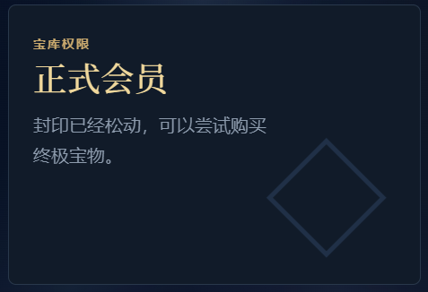
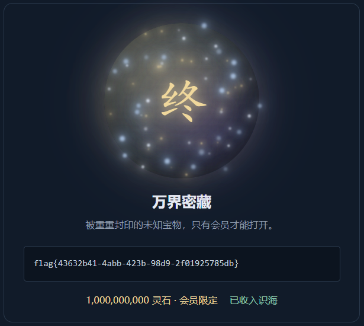
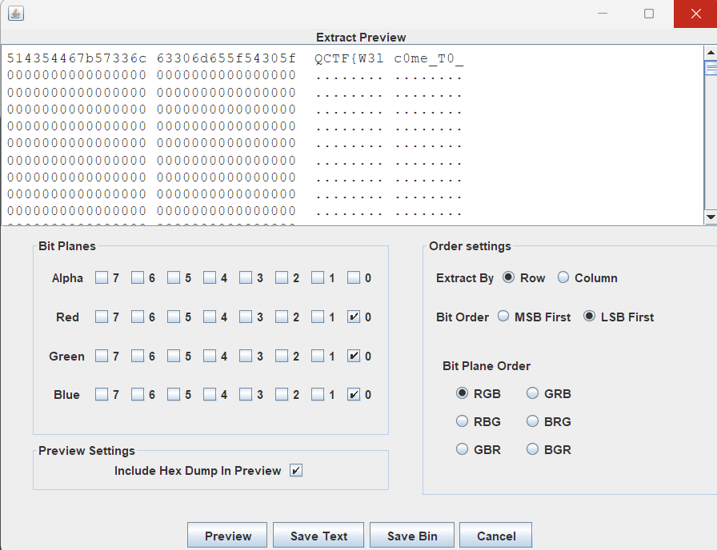
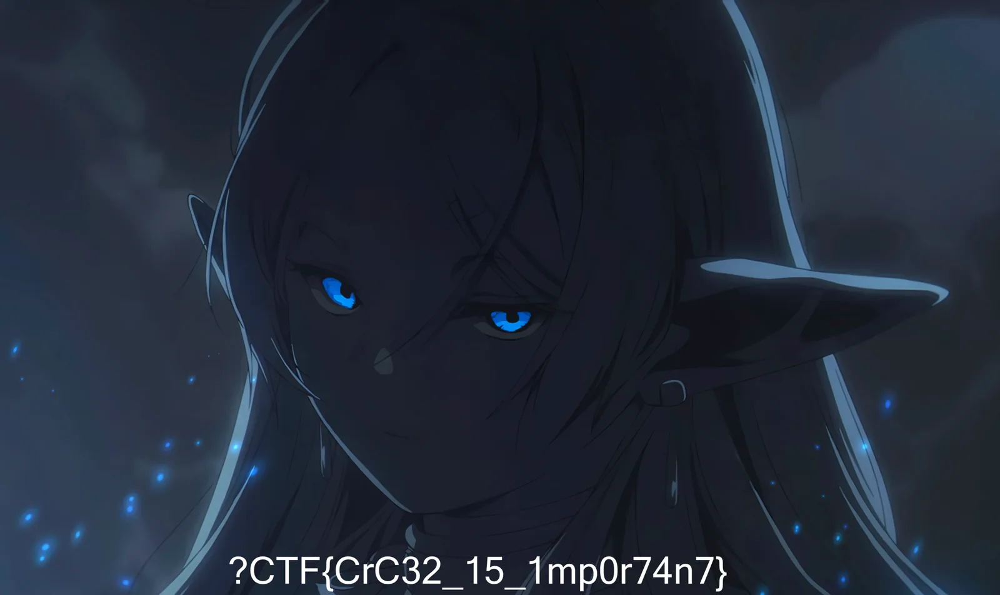

# **?CTF2026 WP by lycat475**

## WEB

#### 万界宝库

先使用guest登录后查看cookies，找到vault_token的值；将值通过JWT解析工具解析后得到payload：

```plain
{
  "sub": "guest",
  "name": "guest",
  "member": false,
  "role": "visitor",
  "iat": 1792323387,
  "exp": 1792330587
}
```

同时购买第二个功法通过base64解码后得到sign：

```plain
the secret is wanjie123456
```

将payload中member的值改为true，role的值改为member，输入signJWT后编码出新的JWT token并填回cookies处后发现权限变为正式会员



_~~然后等一亿秒后灵石积攒到10亿后购买~~_

由于攒的实在太慢了不可能等上三年，观察网络中tick请求发现调用app.js，rate为10

在源代码中搜索rate发现

```plain
rate: Number(window.treasuryConfig.incomePerSecond)
```

搜索incomePerSecond发现

```plain
window.treasuryConfig = {
  incomePerSecond: 10,
};
```

在控制台中修改

```plain
window.treasuryConfig.incomePerSecond=1000000000
```

很快攒满十亿，购买最终宝物后得到flag



## MISC

#### Good match

在查看元素时发现

```plain
<a class="doc-link" id="doc-link" href="/docs" target="_blank" rel="noopener">运气不好？</a>
```

访问 _环境链接_/docs 发现平台开发api文档

找到接口总表 且发现读取指定格子资源为get方式


在浏览器访问 _环境链接_/api/v1/game/cells/_格子号_

可获取全部图案

完成全部翻牌战胜电脑后得到flag

#### **练起来**

放大图片后观察到


“徒步地点更改为防洪纪念碑广场”，疑似某场活动

搜索后发现是2026年新晚报万人徒步嘉年华

同时观察到左侧的“馆”字和右边的欧式建筑，在地图软件上寻找得到拍摄地

地点：哈尔滨

拍摄地：哈尔滨规划展览馆

终点：哈尔滨大剧院

#### 零

解压得到 zero.png

将后缀改为zip解压得到 flag.txt

```plain
?CTF2026_H@ve_Funn!}
```

只有后半段，前面还缺，再回去看图片本身



两段拼起来就是完整 flag

```plain
QCTF{W3lc0me_T0_?CTF2026_H@ve_Funn!}
```

#### 压缩包

frist.zip 为伪加密，用 010 Editor 把两个条目 local header 和中央目录里的 flag 字节 09 改成 00 后就能直接解压，或者按偏移手动解压

txt 的内容

```plain
You are so smart ，
flag{this_is_a_fake_flag}
but there is a string of mysterious characters here:
qctf2026????
do you know what it is? qwq
```

假 flag 没有用，但提示了 final.zip 的密码是 qctf2026 加上 4 个未知字符

final.zip 里的 flag/flag.txt 是 ZipCrypto 加密，所以按提示爆破 4 位后缀，字符集取小写字母+数字

```python
import zipfile, itertools, string
zf = zipfile.ZipFile("final.zip")
for combo in itertools.product(string.ascii_lowercase + string.digits, repeat=4):
    pwd = "qctf2026" + "".join(combo)
    try:
        print(pwd, zf.read("flag/flag.txt", pwd=pwd.encode()))
        break
    except Exception:
        pass
```

跑出来密码是 qctf2026g0od，解密得到 flag

```plain
?CTF{Thi3_is_@_ez_z1p!}
```

#### 被揉坏的芙芙

芙.png打开是一堆彩色像素，用 010 看 PNG 结构，发现只有 IHDR 的 CRC 是 0，其他块（sRGB/gAMA/pHYs/tEXt/IDAT/IEND）的 CRC 都正常，说明只有 IHDR 被动过

IHDR 里宽高是 144 × 1524，但把 IDAT 解压出来长度是 15607284 字节，而 1524 × (1 + 4 × 2560) 正好等于15607284（RGBA每行 1 字节 filter + 4 × 宽度），所以真实宽度应该是 2560

题目里给出的提示 051F503E 其实就是正确 IHDR 的 CRC32，验证了答案

修好之后图片正常显示，flag 就写在图片底部 ~~好飒的芙~~


